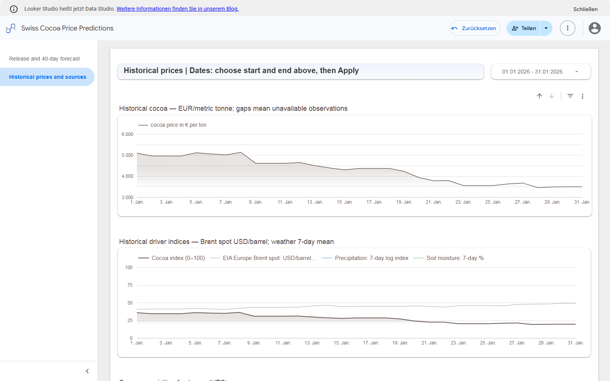
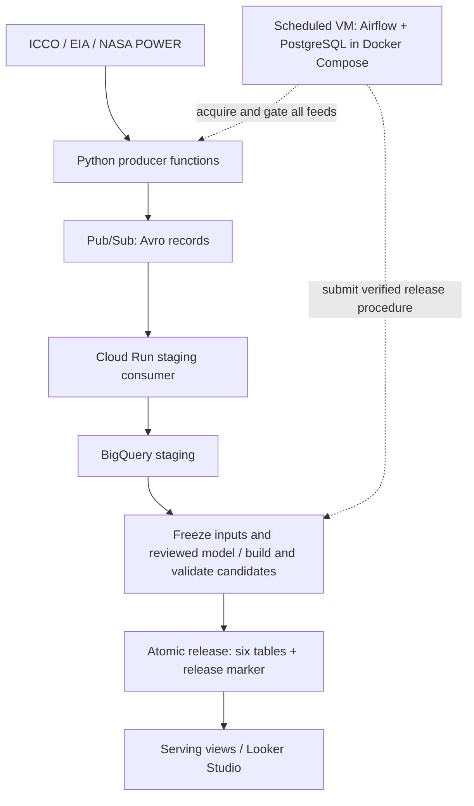

# Cocoa Price Analytics and Forecasting

A Google Cloud analytics system for exploring cocoa prices alongside oil and
weather conditions, with a daily release and one 40-day-ahead price forecast.
Built end to end across Python ingestion, warehouse modeling, infrastructure,
security, BI and operations, it demonstrates how to turn external data into
validated, traceable and recoverable analytical products.

**Stack:** Python 3.11 · Cloud Run functions · Pub/Sub · Cloud Storage · Airflow ·
Docker Compose / PostgreSQL · BigQuery / BigQuery ML · Apache Beam · Terraform ·
Cloud Monitoring · GitHub Actions

**[Explore the dashboard](https://datastudio.google.com/reporting/0458444b-cbb3-4adf-afad-6e9b2ebb93ff)**
· [Review the code](#code-review-route)
· [See validation results](#demonstrated-results)

## Engineering highlights

- **Automated multi-source ingestion:** acquire and reconcile ICCO, EIA and NASA
  POWER data through authenticated, independently deployable services.
- **Trustworthy data products:** require complete feed receipts, enforce source
  freshness, resolve revisions deterministically and validate analytical outputs.
- **Consistent publication:** validate acquisition, quality and predictions before
  releasing six serving tables together, preserving the last accepted product throughout.
- **Secure, reproducible delivery:** scoped identities, Secret Manager,
  Terraform, pinned application artifacts and credential-free CI.
- **Recoverable operations:** retained source inputs, quarantine, dead-letter
  replay, transactional data rollback and encrypted runtime backups.
- **Cost-conscious operation:** scheduled orchestration compute, serverless
  ingestion, bounded warehouse work and manually reviewed model promotion.

## Product preview

[](https://datastudio.google.com/reporting/0458444b-cbb3-4adf-afad-6e9b2ebb93ff)

*Signed-out browser capture, November 2, 2026; January 2026 selected. Charts
preserve source coverage, with gaps identifying unavailable weather observations.*

The two-page report provides historical prices and driver comparisons, one
forecast with origin/target/model context, delivery status, source freshness,
measurement age and imputation, and issued-forecast evaluation. A
[versioned BI contract](bi/looker_studio_report.json) defines units, aggregation,
filters and metrics; [browser and warehouse checks](docs/operations/bi-report.md)
verify the displayed product against accepted releases.

## Architecture and design decisions



| Decision | Engineering reason and tradeoff |
| --- | --- |
| Serverless ingestion; scheduled Airflow VM | Consumers accept deliveries independently of VM uptime. Scheduled LocalExecutor orchestration balances cost and simplicity, with encrypted backups supporting recovery of the single VM. |
| Pub/Sub plus append-only staging | Decouples producers from warehouse processing and tolerates redelivery. Logical deduplication handles expected physical duplicates. |
| Frozen candidates before transactional publication | Validation and retries use the same inputs/model; consumers retain a complete accepted release throughout candidate preparation. Versioned artifacts support reproducibility and rollback. |
| BigQuery SQL and BigQuery ML | Keeps transformations and inference close to warehouse data, simplifying model serving. Explicit query limits and reviewed training runs support cost control. |
| Separate daily and historical paths | Daily acquisition stays small and predictable. Manual Beam backfills produce isolated candidates that require review before normal release publication. |
| Manual training and reviewed promotion | Makes model changes deliberate and traceable; daily runs consistently reuse the reviewed model. |

Supporting paths retain replayable inputs and coverage receipts in GCS, export
quarantine/dead-letter evidence, and feed an independent serverless watchdog.
[Infrastructure ownership](docs/infrastructure/gcp-inventory.md) separates
Terraform resources from application SQL, runtime state and secret values.

## Sources and data model

| Source | Measurement contract |
| --- | --- |
| ICCO | Publisher-dated cocoa prices, EUR/metric tonne; observation date is preserved independently of scrape time. |
| EIA RBRTE | Europe Brent spot, USD/barrel; daily API observations are corroborated against the published table across the acquired interval. The existing `brent_price_eu` field identifies the Europe series and retains its USD/barrel units. |
| NASA POWER | Daily precipitation, mm/day, and dimensionless root-zone wetness at the configured Côte d'Ivoire point; source missingness remains explicit. |

The warehouse uses observation facts and release-versioned analytical tables:

| Layer | Grain, keys and purpose |
| --- | --- |
| Archived acquisition | One exact serialized batch per acquisition/content hash, with schema, request window, source metadata and publication outcomes; object generation and SHA-256 identify retained evidence. |
| Staging | Append-only delivery attempts. `acquisition_id` groups a logical acquisition, `observation_id` identifies dated business content, and `delivery_id` identifies a transport delivery. |
| Curated source facts | One resolved observation per source/date; weather contains two independently resolved measurements. Verified corrections update facts; missing revisions preserve prior valid values. |
| Daily join and features | One row per calendar date. Calendar alignment enables consistent lags/labels; bounded carry retains original measurement age and missingness. |
| Retained releases | Artifacts identified by release/business date, partitioned by business date and clustered by release ID; frozen inputs also cluster by feed. Registry, model, quality and source vintages reproduce each issue. |
| Serving | Six published tables plus stable BI/feature/status views selected through accepted-release metadata. Original issued forecasts remain available after later releases and rollbacks. |

Nine predictors combine current cocoa price, 1/7/28-day lags, seven-row
Brent/rain/wetness means and day-of-week/month categories. The label is cocoa
price at origin +40 calendar days. BigQuery ML uses L2-regularized linear
regression and publishes **one forecast per release for business date +40 days**,
with actual issue time, cutoff, target, units, model and release identity.

[SQL walkthrough](sql/README.md):
[curation](sql/01_curated_data/README.md) →
[features](sql/02_feature_engineering/README.md) →
[training](sql/03_model_training/README.md) →
[prediction](sql/04_prediction/README.md) →
[evaluation](sql/05_evaluation/README.md).

## Data integrity and recovery controls

| Control | Behavior |
| --- | --- |
| Contracts and provenance | Canonical nullable Avro schemas define wire compatibility. Source units, grain, observation date, acquisition and receipt times remain distinct; unknown supplier publication times stay NULL. [Contracts](schemas/README.md), [timestamps](docs/operations/timestamp-provenance.md) |
| Bounded acquisition | Shared deadlines, selective transient retries, `Retry-After` and bounded publish waits; 30-day revision overlap expands after missed runs up to a 90-date automatic window. [Requests](docs/operations/bounded-source-requests.md), [coverage](docs/operations/acquisition-coverage.md) |
| Complete required feeds | All three feeds must pass exact generation/hash-verified receipts, revision inventories, staging reconciliation and measurement-age checks before SQL publication. [Completion gates](docs/operations/required-feed-completion.md) |
| Revision and missingness rules | Verified non-null corrections update facts; missing revisions preserve valid values; conflict checks protect revision integrity. Carry is limited to 7/14/7/7 calendar days for cocoa/oil/rain/wetness, with visible age/imputation flags. [Revisions](docs/operations/deterministic-source-revisions.md), [bounded fill](docs/operations/bounded-forward-fill.md) |
| Quality and atomic publication | Input/output checks reconcile keys, domains, provenance, source values, features, labels and forecast validity. Frozen inputs/model, SQL-body pins, baseline fingerprints and deterministic jobs protect retries; six tables and the marker commit together. [Quality SQL](sql/quality/), [publication](docs/operations/atomic-analytics-release.md) |
| Traceable releases | Durable manifests link code/configuration hashes, acquisitions, receipt generations, model, quality results, task outcomes, fingerprints and warehouse job usage. [Manifests](docs/operations/run-manifests.md), [issued history](docs/operations/issued-forecast-history.md) |
| Retained inputs and safe replay | Batches persist before publishing; create-only writes, versioning and 400-day lifecycle policies support later recovery. Replay preserves original acquisition time and identities. [Input archive](docs/operations/daily-raw-inputs.md), [retry ownership](docs/operations/retry-delivery.md) |
| Quarantine and dead letters | Invalid records require checksum-verified durable evidence before acknowledgement; transient/ambiguous sink failures retry. Exhausted transport deliveries export original bytes/metadata for ledger-controlled replay. [Quarantine](docs/operations/invalid-record-quarantine.md), [dead letters](docs/operations/dead-letter-recovery.md) |
| Historical repair | Held generation/hash-pinned sources, bounded isolated Beam candidates, validation evidence and reviewed plans enter the next atomic release; freshness and approval checks protect the repair workflow. [Backfill and repair](docs/operations/safe-backfill-repair.md) |
| Data and runtime restore | Fingerprint-checked transactional rollback restores retained serving releases. Encrypted PostgreSQL/configuration backups retain image hashes and exact secret key-version references. [Rollback SQL](sql/procedures/rollback_analytics_release.sql), [runtime restore](docs/operations/runtime-backup-restore.md) |

## Security, operations and delivery

- **Least privilege:** separate producer, orchestration, staging and watchdog
  identities; resource/prefix-scoped IAM, authenticated functions, OIDC transport,
  IAP-restricted administration and private application buckets. Metadata credentials
  and short-lived operator tokens avoid downloaded service-account keys.
- **Secret and source governance:** Secret Manager, sanitized logging,
  secret-access audits, retained backup key versions, publisher attribution and
  explicit data-use terms. Secret values stay outside Git, Terraform and bundles.
  [Security controls and permission probes](docs/operations/security-governance.md)
- **Reproducible infrastructure and releases:** separate main/bootstrap Terraform
  roots with private versioned state; deterministic function ZIPs, Git-pinned
  bundles, SHA-pinned Actions, digest-pinned images and resolved Python constraints.
  Reviewed promotion preserves compatible DAG/routine pins and rollback artifacts.
  [Terraform](infra/terraform/README.md), [deployment](docs/operations/application-deployment.md)
- **Operational visibility:** correlated structured logs and a dashboard for run
  outcomes, source ages, request errors/p95 latency, backlog/dead letters and VM
  health. An independent watchdog detects missed starts/runs/deadlines; actionable
  email alerts cover blocked publication, quarantine, backup and monitor failures.
  [Telemetry](docs/operations/operational-telemetry.md), [alerts](docs/operations/actionable-alerts.md)
- **Bounded execution and cost:** Berlin/DST-aware weekday VM start 18:30,
  DAG 19:00, delivery deadline 20:00 and daily shutdown 20:30; health-gated startup,
  one active run and stale-work guards. Zero serverless minimums, instance caps,
  lifecycle policies, query limits/quotas, resource labels and budget alerts bound
  usage. [Scheduling](docs/operations/safe-vm-scheduling.md), [FinOps](docs/operations/finops.md)

## Demonstrated results

Recorded cloud exercises and product verification demonstrate the controls in action:

| Exercise | Observed result | Evidence |
| --- | --- | --- |
| Delivery recovery | With warehouse permission deliberately denied, the consumer retained retryable delivery with zero writes. Restoring permission allowed the original delivery to succeed independently of the stopped orchestration VM. | [Isolated cloud drill](docs/operations/recovery-demonstration.md) |
| Transactional resilience, October 29, 2026 | Controlled interruption at three publication stages preserved all six serving fingerprints. Retry reused frozen inputs; rollback restored the baseline, with integrity guards detecting stale markers and altered artifacts. | [Isolated BigQuery drill](docs/operations/atomic-analytics-release.md#validation) |
| Runtime restoration, October 30, 2026 | Encrypted metadata and saved images restored into isolation in 116.39 seconds, including connection decryption, DAG import and scheduler checks. | [Native restore](docs/operations/runtime-backup-restore.md) |
| Historical repair, November 2, 2026 | Published 218 archived Brent prices through the reviewed repair/release path; all matched the archive, and a signed-out date-filter check rendered the repaired series. | [Production repair and browser verification](docs/operations/bi-report.md#published-consumer-corrections-november-2-1421-berlin) |

Validation combines [credential-free CI](.github/workflows/ci.yml) for lint,
syntax, deterministic packaging and unit/contract tests; [runtime component
checks](docs/operations/integration-testing.md) for real Functions Framework,
Airflow failure propagation and Beam DirectRunner IO; and isolated cloud probes
for permissions, sink/replay behavior and publication SQL. Secret scanning and
weekly/manual dependency audits run in a separate [security workflow](.github/workflows/security.yml).

## Forecasting, evaluation and operating scope

- **Traceable forecasting:** BigQuery ML combines cocoa price history, oil,
  weather and calendar features to produce a reproducible 40-day-ahead forecast.
  Original predictions, inputs, model versions and actual-data vintages are
  retained so each forecast can be evaluated as its target outcome becomes available.
- **Structured evaluation:** chronological simulations and issued-forecast
  tracking compare model results with persistence and weekly-seasonal benchmarks.
  A documented 53-origin local ridge experiment informs model development;
  fitted historical scores are labeled separately. Live predictive performance
  remains under evaluation, with sample counts and outcome availability visible.
  Historical simulations use revised source history and explicit publication-lag
  assumptions. [Methods and benchmark results](docs/operations/chronological-evaluation.md)
- **Reviewed model development:** candidate promotion requires an explicit
  training cutoff, at least 365 training rows, 20 matched held-out origins,
  valid predictions and a baseline-relative MAE gate, followed by reviewed
  selection. Model cards preserve the decision and supporting evidence.
  [Promotion criteria](docs/operations/manual-model-policy.md)
- **Measurable service objectives:** targets are 99% on-time over 100 operating
  weekdays, at most one operating day of acquisition loss and recovery by the
  next deadline. The documented lookup verified one on-time scheduled run;
  three earlier weekdays remained unverified. Longer-term reliability is an
  ongoing measurement. Recurring hosting targets below EUR 5/month, with EUR 10
  acceptable, are tracked separately from development costs; an ordinary operating
  month's bill remains to be established. Budget notifications support spending
  review alongside technical usage controls.
  [Service evidence](docs/operations/operational-handoff.md), [cost measurements](docs/operations/finops.md)
- **Explicit security and access scope:** scoped IAM, private administration and
  dependency audits support the portfolio deployment. Airflow 2.10.2 and optional
  Beam dependencies retain documented security advisories; the temporary Airflow
  exception is due for review November 30, 2026. Main workloads use regional
  infrastructure, with automatically replicated secrets and global logs. Public
  BI uses delegated owner credentials and query allowance; source-level caching
  means charts can briefly display different release context.
  [Security review](docs/operations/security-governance.md), [BI access and refresh](docs/operations/bi-report.md)

## Code review route

| Start here | What to inspect |
| --- | --- |
| [Airflow DAG](airflow/dags/cocoa_daily.py) | Required-feed dependency chain, receipt reconciliation, bounded execution and deterministic job handling. |
| [Release procedure](sql/procedures/run_analytics_release.sql) and [quality checks](sql/quality/) | Frozen inputs, independent validations, candidate retention and transactional publication. |
| [Terraform](infra/terraform/) | Identity/network boundaries, state ownership, storage, scheduling and monitoring resources. |
| [Recovery tests](tests/unit/test_recovery_handoff.py) and [native recovery matrix](docs/operations/recovery-demonstration.md) | Process-death/redelivery semantics, archived-input replay and the boundary between local and cloud evidence. |
| [Release packager](scripts/deploy/package_release.py) | Git-pinned artifacts, manifest verification and separation of packaging from deployment. |

## Run local checks

Create and activate a Python 3.11 environment (`py -3.11 -m venv .venv` on
Windows or `python3.11 -m venv .venv`), then run:

```bash
python -m pip install -r requirements-dev.txt
python -m ruff check .
python scripts/development/check_syntax.py
python scripts/deploy/package_functions.py all
python -m pytest -q --basetemp=.build/pytest
git diff --check
```

These checks require no GCP credentials; tests block external sockets. Bash is
needed for shell checks (`check_syntax.py --python-only` checks Python alone).
Packaging creates five self-contained function roots/ZIPs in `.build/functions/`.
Keep development, operations, evaluation, function, Airflow and Beam dependencies
in separate environments. Cloud deployment/recovery follows the linked runbooks.

Full source archives and private receipts stay outside Git; the
[historical manifest](data/historical_manifest.yaml) records snapshot generations,
coverage and checksums. Code uses [Apache License 2.0](LICENSE); third-party data
retains its own terms and attribution.
